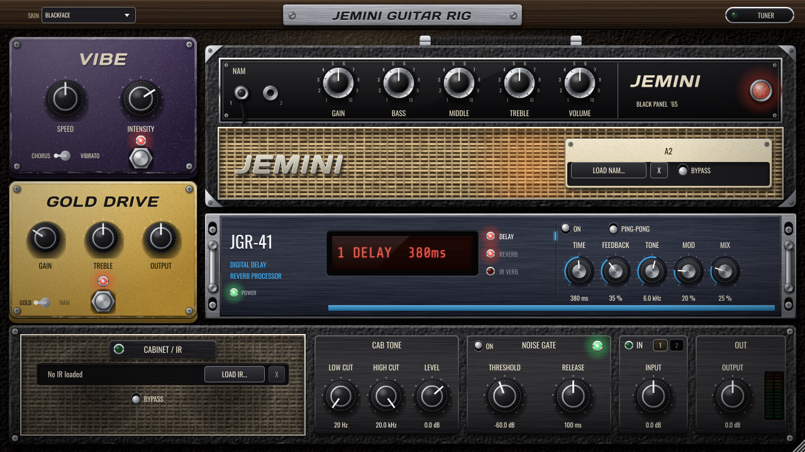

# Jemini Guitar Rig

_(repository and project files keep the original working name "VintageGuitarSuite")_



The window is resizable (drag the bottom-right corner); the size is saved with the project.

VST3 guitar amp & effects plugin built with JUCE (C++17) for Windows / Cubase 12.

## Signal chain (v1)

Uni-Vibe → Klon-style Overdrive → NAM Amp (Fender Dual Showman captures) → Cabinet IR → Lexicon-style Delay/Reverb

Each module has its own bypass.

## Third-party

See `ThirdParty/README.md` (NeuralAmpModelerCore - MIT, Eigen - MPL2, nlohmann/json - MIT).

## Roadmap

1. Basic plugin (input/output gain)
2. NAM amp
3. Cabinet IR
4. Pedals (Uni-Vibe, Klon-style OD)
5. Delay / reverb
6. Vintage GUI (black-panel Dual Showman + Lexicon-style rack)
7. Advanced features (dual IR, routing, presets)

## Build (Windows)

1. Open `VintageGuitarSuite.jucer` in Projucer.
2. Check that the JUCE global path is set: **File → Global Paths → Path to JUCE** (e.g. `C:\JUCE`) and **JUCE Modules** (e.g. `C:\JUCE\modules`).
3. Click **Save and Open in IDE** (Visual Studio 2026).
4. In Visual Studio, set the configuration to **Release / x64**, right-click **VintageGuitarSuite_VST3** → **Build**.
5. Copy `Builds\VisualStudio2026\x64\Release\VST3\JeminiGuitarRig.vst3` to `C:\Program Files\Common Files\VST3\`.
6. In Cubase: **Studio → VST Plug-in Manager → Rescan**.

## Project layout

```
VintageGuitarSuite.jucer   Projucer project
Source/
  PluginProcessor.h/.cpp   audio processing + parameters
  PluginEditor.h/.cpp      GUI
```

## Standalone app

The project also builds a standalone Windows app (no DAW needed):
`Builds/VisualStudio2026/x64/Release/App/JeminiGuitarRig.exe`.

On first launch open **Options → Audio/MIDI Settings**, choose your audio
interface (ASIO driver if available), enable the input your guitar is on
(input 1 is used) and untick **Mute audio input** (it is muted by default to
avoid feedback through speakers — use headphones or an amp/monitor setup).

## Drive slot: Gold Drive or NAM pedal

The second pedal slot holds either the built-in **Gold Drive** or a **NAM
DRIVE**: a NAM capture of a real drive pedal. Flip the GOLD / NAM switch on the
pedal. The NAM pedal keeps the capture's real level (no loudness
normalisation) and has INPUT, TONE (treble shelf) and OUTPUT controls. The
footswitch turns whichever pedal is selected on or off; the model path is
saved with the project.
